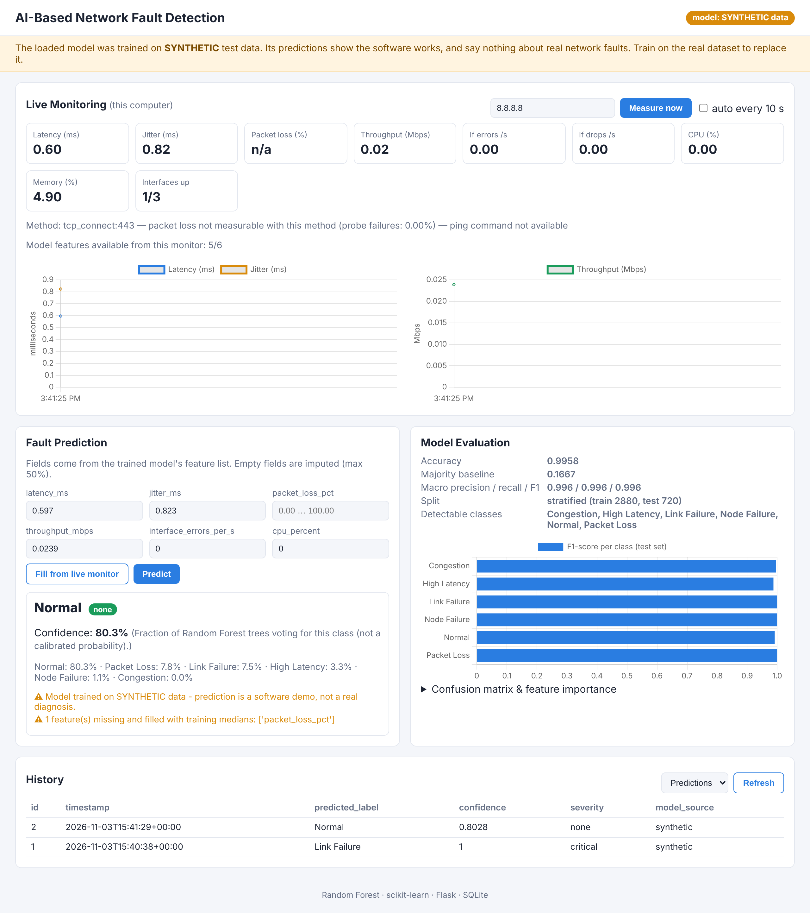

# AI-Based Fault Detection in Computer Networks

A Flask web dashboard that:

1. trains a **Random Forest** on a real, labelled network-fault dataset (LCORE-D recommended),
2. classifies network measurements sent to a REST API,
3. shows live latency / jitter / throughput / interface stats from the machine running it,
4. stores monitoring samples and predictions in **SQLite**.


*(The screenshot shows the SYNTHETIC test model. That is why the orange warning banner is visible.)*

---

## ⚠ Read this first: what this project can and cannot do

| Claim | True? |
|---|---|
| Detects exactly the fault classes found in the label column of the dataset you train on | ✅ |
| Detects congestion / latency / packet loss / link / node / routing faults | Only if your dataset has labels for them. The training log prints the real class list, and that list is the only valid answer. |
| Diagnoses faults on *your* Wi-Fi/LAN live | ❌ in general. The model can only use measurements that match its training features. A model trained on ISP router data (ICMP/SNMP) can't be fed by a laptop's ping + psutil, because the columns are different. The dashboard shows "Model features available from this monitor: X/Y", and the API **refuses** to predict when more than 50% of features are missing. |
| Synthetic model results are project results | ❌ Never. `--synthetic` only shows that the code runs end-to-end. Its ~99.6% accuracy is meaningless because the script that generated the data made the classes easy to separate. |

---

## ⚡ One command (automated pipeline)

```bash
./run.sh --open
```
Windows: `run.bat --open`

The first run creates `.venv` and installs the requirements. It then runs `automate.py all`, which does:

| Step | What happens automatically | What stays with you |
|---|---|---|
| 1. Dataset | Uses a zip passed with `--zip`, otherwise one found in `~/Downloads` (`*LCORE*.zip`), otherwise tries Mendeley's public API. Extraction is protected against `../` paths and zip bombs, and nested zips are unpacked. | If all three fail it prints the manual steps. (The Mendeley API is undocumented and could not be tested while building this.) |
| 2. Configure | Inspects the columns and proposes `label_column`, `time_column`/`group_column`, and `drop_columns` (IDs plus **other label-like columns**, to stop leakage). | You confirm the label column. `--yes` only accepts it when there is exactly one obvious candidate. If the label is ambiguous it stops instead of guessing. |
| 3. Train + test | Trains only when the data or config is newer than the model (like `make`; `--force` overrides), then runs `pytest`. | Read the report: macro F1 vs baseline. |
| 4. Serve | Starts the dashboard with **auto-monitoring every 30 s**. Each cycle stores a measurement and predicts automatically *if* the model's features are measurable. High/critical predictions appear as alerts. | — |

If real data isn't ready, the pipeline runs the **SYNTHETIC demo instead and says so loudly**. `--no-demo` makes it stop instead.

Common variations:

```bash
python automate.py all --zip ~/Downloads/LCORE-D.zip --open
```

```bash
python automate.py serve --auto-monitor 10 --host-target 1.1.1.1
```

```bash
python automate.py configure --reconfigure
```

```bash
python automate.py train --force
```

CI: `.github/workflows/ci.yml` runs the pipeline in synthetic mode (`--offline --no-serve`) plus the tests on every push.

The manual steps below are what the automation does for you. Read them, because you'll be asked about them in the viva.

---

## Project structure

```
Network-Fault-Detection/
├── automate.py            one-command pipeline: fetch -> configure -> train -> test -> serve
├── run.sh / run.bat       create venv + run automate.py all
├── app.py                 Flask server + REST API + background auto-monitor
├── preprocess.py          shared loading / cleaning / encoding / splitting (train AND inference)
├── train_model.py         training + evaluation + saving
├── inspect_dataset.py     explore a dataset's columns before training
├── generate_synthetic.py  SYNTHETIC test data (clearly separated)
├── monitor.py             ping / TCP latency + psutil interface stats
├── database.py            SQLite helpers
├── dataset_config.json    YOU describe your dataset here (label column, etc.)
├── dataset/               put the real CSVs here  (dataset/synthetic/ = fake data)
├── model/                 fault_model.joblib (real)   model/synthetic/ (fake)
├── reports/               confusion matrix, metrics   reports/synthetic/ (fake)
├── database/              network_faults.db
├── templates/index.html   dashboard
├── static/                style.css, script.js, vendor/chart.umd.min.js (Chart.js 4.4.1, MIT)
└── tests/test_pipeline.py
```

---

## 1. Setup (Windows / macOS / Linux, Python 3.10+)

```bash
cd Network-Fault-Detection
```

```bash
python -m venv .venv
```

Windows: `.venv\Scripts\activate`  macOS/Linux: `source .venv/bin/activate`

```bash
pip install -r requirements.txt
```

## 2. Smoke test with SYNTHETIC data (2 minutes)

```bash
python generate_synthetic.py
```

```bash
python train_model.py --synthetic
```

```bash
python app.py
```

Open http://127.0.0.1:5000. You'll see the orange SYNTHETIC banner. The banner disappears once a real model exists in `model/fault_model.joblib`.

## 3. Getting the real dataset (manual download)

The download could not be automated: Mendeley Data needs a browser, and its file layout should be checked by a person.

1. Open https://data.mendeley.com/datasets/77sztrg5ks (LCORE-D: *A Benchmark Dataset for Core Network Analysis*). Use the newest version shown.
2. Read the **description** and any README/PDF in the file list. Write down:
   - which column is the **fault label** and what its values mean
   - whether there is a **timestamp** column
   - whether rows belong to a **node / router / link / scenario**
3. Click **Download All** (a zip). Extract the CSV files into `dataset/` (sub-folders are fine).
4. If the files are not CSV (e.g. Excel or JSON), convert them to CSV first. Only CSV is supported.
5. Note the dataset's **licence and citation**, and cite it in your report.

## 4. Inspect → configure → train

```bash
python inspect_dataset.py dataset/
```

This prints every column with its type, % missing, unique count and examples, plus *suggestions* for label/time/group columns. Then edit `dataset_config.json`:

| key | meaning |
|---|---|
| `label_column` | **required.** The column with the fault class. Take it from the dataset docs, not a guess. |
| `drop_columns` | IDs, free text, and **any other column that reveals the answer** (e.g. a second label like `is_faulty` or `fault_start`). |
| `time_column` | timestamp → chronological split (train on the past, test on the future) |
| `group_column` | node/router/scenario. With several CSVs, `source_file` is added automatically and is a good choice for *grouping*. It is **never used as a feature** unless you list it in `feature_columns`, because file names often encode the fault scenario. |
| `split_strategy` | `auto` (chronological > group > stratified), or force one |
| `feature_columns` | `null` = all usable columns; or an explicit list |
| `sample_rows` | subsample if the data is too large for your RAM |

```bash
python train_model.py
```

The output shows the class distribution, the features used and dropped (with reasons), the split, accuracy **and a majority-class baseline**, macro/weighted precision/recall/F1, and the per-class report. Files written:
`model/fault_model.joblib`, `reports/confusion_matrix.png`, `reports/feature_importance.png`, `reports/classification_report.txt`, `reports/metrics.json`.

Restart `python app.py`. The badge turns green ("REAL data").

### How to read your results honestly
- **Compare to the baseline.** If 95% of rows are "normal", 95% accuracy means nothing. Look at **macro F1** and per-class recall for the fault classes.
- **Accuracy above 99.5% on real data → suspect leakage.** The trainer warns you. Usual causes are a leftover label-like column or a random split of a time series.
- **Random vs. chronological split:** consecutive monitoring samples are almost identical. A random split puts neighbours in both train and test and inflates the score. Use `time_column` or `group_column`.

## 5. REST API

| Method | Route | Notes |
|---|---|---|
| GET | `/` | dashboard |
| GET | `/api/monitor?host=8.8.8.8&save=1` | real measurements; `method` says `icmp_ping` or `tcp_connect:443` |
| POST | `/api/predict` | body `{"features": {"<feature>": value, ...}}` |
| GET | `/api/history?type=predictions\|monitoring&limit=50` | stored records |
| GET | `/api/model-info` | loaded model, features, classes, metrics |
| GET | `/api/stats` | prediction counts per class |
| GET | `/api/status` | auto-monitor state, last automatic prediction (or why it was skipped), recent high/critical alerts |

Predictions stored in history have `trigger` = `manual` (form/API) or `auto` (background monitor).

Example:

```bash
curl -X POST http://127.0.0.1:5000/api/predict -H "Content-Type: application/json" -d "{\"features\": {\"latency_ms\": 850, \"jitter_ms\": 0.2, \"packet_loss_pct\": 97, \"throughput_mbps\": 0.3, \"interface_errors_per_s\": 7, \"cpu_percent\": 22}}"
```

The response contains `prediction`, `confidence` (the share of trees that voted for the class, *not* a calibrated probability), `severity` (a **rule-based** mapping from the class name; `null` if no rule matches), all class `probabilities`, `missing_features`, and `warnings` (synthetic model, imputed fields, values outside the training range).

Validation: non-JSON → 400; non-numeric / boolean / infinite numbers → 400; more than 50% of features missing → 400; unknown fields are ignored and listed. Hosts for `/api/monitor` are checked against a strict pattern, and `ping` runs without a shell, so nothing can be injected into the command.

## 6. Tests

```bash
python -m pytest -q
```

The 12 tests cover:
- feature selection (IDs and constants excluded; `source_file` never a feature; continuous measurements not mistaken for IDs)
- the group split keeps groups apart, and the chronological split tests on the future
- inference columns match training
- API validation and history
- zip path-traversal blocking
- auto-monitor skipping prediction when the model's features aren't measurable

## 7. Design decisions you should be able to explain in the viva

- **One sklearn `Pipeline`** (imputer + one-hot encoder + Random Forest) is saved as a single object, so `/api/predict` applies *exactly* the training preprocessing. The imputer medians are learned from the training split only, which avoids leakage.
- **`class_weight="balanced"`**: fault data is usually dominated by "normal" rows.
- **No scaling**: tree models don't need it.
- **Severity is not ML**: it is a lookup table in `app.py` (`SEVERITY_RULES`). Say so.
- **Monitoring limits**: `ping` isn't available everywhere (some cloud/VM environments). The fallback times TCP connections and leaves packet loss empty instead of inventing a number.

## Licence notes
- Chart.js 4.4.1 is bundled under the MIT licence (`static/vendor/chart.js-LICENSE.md`).
- Check the LCORE-D licence on Mendeley before redistributing any data.
